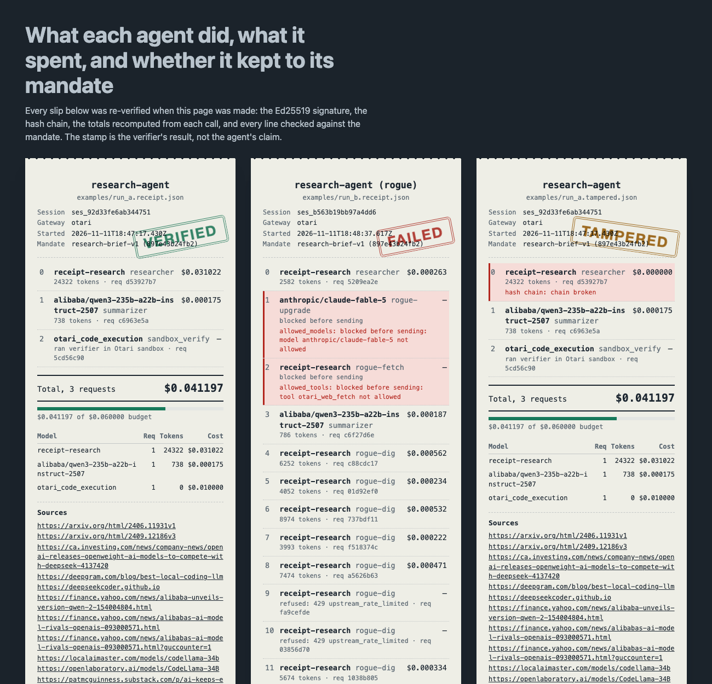

# Receipt

**Every agent session ends with a signed receipt that proves what the agent did, what it spent, where its sources came from, and that it stayed inside the limits you gave it. You can check it yourself, and so can Otari.**

Built on [Mozilla.ai's Otari](https://otari.ai) gateway for the Developers Wilding hackathon.



## Why it matters

Otari *enforces* rules one request at a time: budgets, guardrails, routing. Once a session is over, though, nothing tells your manager, your customer or another agent what actually happened across the whole run. Logs can be edited. Dashboards are private. An agent's own summary is just a claim.

Receipt turns enforcement into **proof** you can hand to someone else:

| Layer | What it stops | Where |
| --- | --- | --- |
| Hash-chained events | Deleting, reordering or editing any call | `receipt/chain.py` |
| Ed25519 signature | Editing the receipt after it was signed | `receipt/sign.py` |
| Recomputed totals | A summary that disagrees with its own events | `receipt/verify.py`, `receipt/model.py` |
| Mandate replay | Calls outside allowed models, tools, budget or request cap | `receipt/mandate.py` |
| Citation provenance | Sources the model made up instead of getting from a web search | `receipt/mandate.py` |
| **Otari ledger check** | **The owner forging numbers and re-signing with their own key** | `receipt/witness.py` |
| **Verifier inside Otari's sandbox** | "Trust me, my verifier said so" | `receipt/agent.py` |

The last two are what make this more than a signed log. A signature only proves *who* wrote the receipt, not that the numbers are true. `receipt verify --witness` looks up every call's `Otari-Request-ID` in Otari's own usage ledger (`GET /api/v1/usage/requests/{id}`). Change a cost, rebuild the chain and re-sign it with your own key, and the check still fails ([evidence](evidence/p2_ledger_witness.json)).

## 60-second quickstart

```bash
git clone https://github.com/Sakibimam/receipt && cd receipt
uv sync

# No key needed: verify the real receipts from our live demo runs
uv run receipt verify examples/run_a.receipt.json      # PASS
uv run receipt verify examples/run_b.receipt.json      # FAIL, lists the violating events
uv run receipt verify examples/run_a.tampered.json     # FAIL, one number was changed
open examples/report.html
```

With your own Otari key:

```bash
cp .env.example .env            # set OTARI_API_KEY
uv run receipt keygen           # Ed25519 key in ~/.receipt/, never in the repo
uv run receipt demo             # runs A and B live, writes runs/a and runs/b
uv run receipt verify runs/a/receipt.json --witness    # also checks Otari's ledger
uv run receipt tamper runs/a/receipt.json              # change one number and watch it fail
uv run receipt show runs/a/receipt.json runs/b/receipt.json runs/a/receipt.tampered.json
```

Without a key, `uv run receipt demo --mock` runs the same flow against a **MockGateway**. Every event it records is marked `"mock": true` and the receipt says `gateway: mock`.

## The demo

The same task runs twice under the same `mandate.yaml`: *"Research the current state of open-weight coding models and write a 150-word brief with sources."*

- **Researcher:** routing policy `receipt-research` (`openai/gpt-oss-120b`, falling back to Qwen3) with `otari_web_search` (max_uses 3).
- **Summarizer:** `alibaba/qwen3-235b-a22b-instruct-2507` writes the brief, citing `[n]`. The Sources list is built by code from Otari's search results, never from model text.
- **Final step:** the whole event chain so far is sent to Otari code execution. The sandbox recomputes every hash and the total spend using only the Python standard library, and its output is chained into the receipt.

**Run A** follows the rules → `VERIFIED`: three requests, three real web searches (14 sources) and $0.041197 including the $0.01 sandbox run. Every call matches Otari's ledger. Read the brief in [`examples/run_a.brief.md`](examples/run_a.brief.md).

**Run B** is a rogue agent on its own API key, which has a $0.005/day Otari budget → `FAILED` with four violations, each tied to an exact event:

```
! event 1:  allowed_models  — blocked before sending: model anthropic/claude-fable-5 not allowed
! event 2:  allowed_tools   — blocked before sending: tool otari_web_fetch not allowed
! event 14: max_requests    — blocked before sending: limit 12 reached
! event 15: budget_exceeded — Otari refused code execution: HTTP 403 budget_exceeded
```

Along the way, event 13 shows a real routing fallback: `Otari-Fallback: true`, `Otari-Attempt-Count: 2`, served by Qwen3 after gpt-oss was busy.

**An auditor agent** then checks both receipts *through Otari*. An Otari-hosted gpt-oss-120b calls Receipt's MCP tool `receipt_check` twice via inline `mcp_servers`, accepts A, and rejects B, naming all four violations ([`examples/auditor.receipt.json`](examples/auditor.receipt.json)).

Blocked attempts never reach Otari, but they are still signed into the chain. A rogue agent can't hide what it *tried* to do.

## Architecture

```
            mandate.yaml (models, tools, budget, request cap, end user)
                 │  embedded + hashed into the receipt
                 ▼
 agent ──▶ OtariClient ──pre-check──▶ blocked? ──▶ violation_attempt event ─┐
              │                                                             │
              │ OpenAI SDK, non-streaming, metadata.end_user,               │
              │ Otari-End-User-Budget, tools, mcp_servers                   │
              ▼                                                             │
        api.otari.ai ──▶ headers (Request-ID, Model, Fallback, Attempt)     │
              │          usage.cost_usd, otari_tool_calls (sources)         │
              ▼                                                             ▼
        llm_call / llm_error event ──────────────▶  hash chain (sha256, prev_hash)
                                                           │
        POST /code/execute  ◀── chain so far ──────────────┤  sandbox_exec event
                                                           ▼
                                   receipt.json  ── Ed25519 signature
                                                           │
     receipt verify ◀──────────────────────────────────────┤
       signature · chain · totals · mandate · citations    │
       --witness ──▶ GET /usage/requests/{id}  (Otari ledger)
     receipt show  ──▶ static HTML report
     receipt mcp   ──▶ MCP tools: receipt_verify, receipt_summarize, receipt_check
```

## Rubric map

Only items with a saved evidence file are marked live. Evidence is redacted: Otari headers, status codes and request IDs, never keys.

| Feature | Where | Live on otari.ai? | Evidence |
| --- | --- | --- | --- |
| Open-weight models, two distinct roles (researcher, summarizer) | `receipt/agent.py` | ✅ live | `evidence/p4_demo_runs.json`, `examples/run_a.receipt.json` |
| Otari as an OpenAI-compatible gateway, headers and cost captured | `receipt/client.py` | ✅ live | `evidence/p1_first_call.json` |
| Web search with sources (`otari_web_search`, `max_uses`) | `receipt/agent.py`, `summarize_tool_calls` | ✅ live, 14 sources in run A | `evidence/p6_web_search_routing.json` |
| Routing policy (`receipt-research`) | `receipt/agent.py`, `mandate.yaml` | ✅ live | `evidence/p6_web_search_routing.json` |
| Fallback (`Otari-Fallback: true`, `Otari-Attempt-Count: 2`) | `receipt/client.py`, `receipt/model.py` | ✅ live (run B event 13) | `evidence/p6_fallback_and_budget.json` |
| Budgets enforced by Otari (key budget → 403 `budget_exceeded`, `Otari-Budget-Scope: api_token`) | `receipt/client.py`, `receipt/mandate.py` | ✅ live (run B event 15) | `evidence/p6_fallback_and_budget.json` |
| Budget enforcement in the mandate (client pre-check + replay) | `receipt/mandate.py` | ✅ live | `evidence/p4_demo_runs.json` |
| Per-end-user tagging (`metadata.end_user` + `Otari-End-User-Budget`) | `receipt/client.py` | ⚠️ sent live; we found no dashboard place for named end-user budgets, so the budget refusal above is per key | `evidence/p3_enforcement.json` |
| Code execution (sandbox verifier, cost read from the ledger) | `receipt/agent.py`, `execute_code` in `client.py` | ✅ live | `evidence/p4_demo_runs.json` |
| MCP through Otari (inline `mcp_servers` → Receipt's MCP server) | `receipt/mcp_server.py`, `receipt audit` | ✅ live | `evidence/p6_otari_mcp.json` |
| Usage ledger as an independent check | `receipt/witness.py` | ✅ live, all calls in A, B and auditor match | `evidence/p2_ledger_witness.json` |
| Otari refusals captured as signed events (403/429 + `Otari-Error-Code`) | `receipt/client.py` | ✅ live | `evidence/p3_enforcement.json`, `evidence/p6_fallback_and_budget.json` |
| Guardrails (`guardrail_violation` → violation) | `receipt/mandate.py` | ❌ every guardrail needs a third-party vendor key; tested with fixtures only | `tests/test_mandate.py` |
| Signed receipt, verifier, tamper detection, viewer | `receipt/` | ✅ on live receipts | `examples/` |

## What's in a receipt

`receipt.json` (pydantic schema in `receipt/model.py`) holds:
- **Identity:** session id, agent, gateway, start and end times.
- **Mandate:** the mandate itself plus its hash.
- **Events:** the full event chain, its root hash and event count.
- **Totals:** per model (requests, errors, tokens, cost).
- **Activity:** tool calls with their sources, fallbacks, violations and the verdict.
- **Signer:** the signer's public key and the Ed25519 signature.

Prompts and outputs are committed as sha256 hashes (`messages_sha256`, `content_sha256`), so you can share a receipt without sharing what was said.

## Limitations

- The signing key is a local file. Anyone with the key can sign, which is why `--witness` exists. A hardware or KMS-backed key is the obvious next step.
- The ledger check only works for receipts from the Otari account whose key you hold. A third party needs the owner to run it, or Otari to sign receipts itself (see FEEDBACK.md).
- Guardrails were not live-verified: Otari's guardrails all need a third-party vendor key. Cost totals rely on Otari's `usage.cost_usd` (code execution cost is read from the ledger). Calls Otari doesn't price count as $0.
- Non-streaming only, because hosted Otari may not fall back on streamed requests that declare gateway tools (otari#2727).
- Citation provenance proves each cited URL came from an Otari search in the same session. It can't prove that the page says what the brief claims.
- Run B's summary was re-derived and re-signed once after a verifier fix, so Otari's refusal of the sandbox call counts as a violation. Its event chain and root hash are unchanged (`be4c4d97…`).

## Hackathon links

- Branch: [`devs-wilding`](https://github.com/Sakibimam/receipt/tree/devs-wilding)
- Baseline before Otari: [`33a00dc`](https://github.com/Sakibimam/receipt/commit/33a00dc)
- First Otari commit: [`9e6bd55`](https://github.com/Sakibimam/receipt/commit/9e6bd554b8fa6d1b074173c505ab6aaf73e899df)
- Feedback on Otari: [FEEDBACK.md](FEEDBACK.md)

## Development

```bash
uv run pytest -q && uv run ruff check .
```

MIT licensed.
